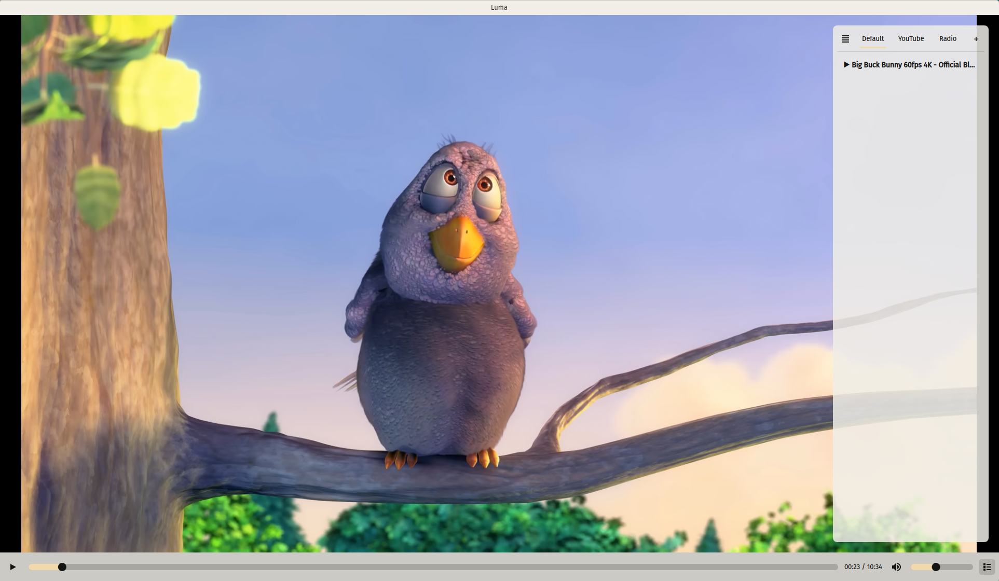
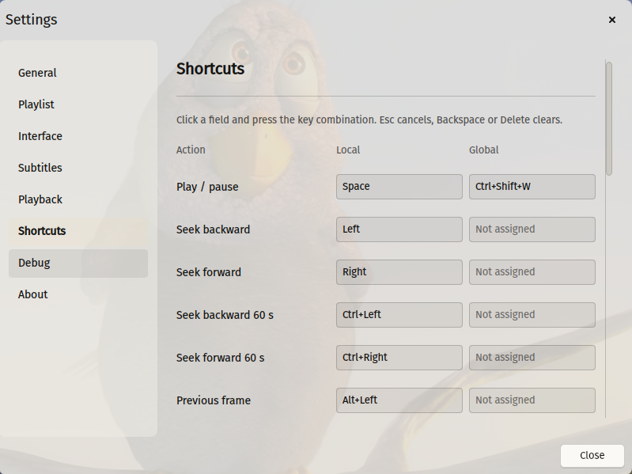

<p align="center">
  
</p>

<h1 align="center">Luma</h1>

<p align="center">
  A lightweight, fast media player for Linux built on <b>mpv</b> and <b>Qt 6 / QML</b> (Kirigami).
</p>

> **Platform: Wayland only.** Luma is built for Wayland sessions (KWin, GNOME, Sway,
> Hyprland, …). X11 is **not** supported, and support for it is **not planned**. The
> application refuses to start without a Wayland session.

<p align="center">
  <a href="https://www.qt.io/"></a>
  <a href="https://wayland.freedesktop.org/"></a>
  <a href="https://www.gnu.org/licenses/gpl-3.0"></a>
</p>

<p align="center">
  <a href="docs/readme/README.ru.md">Русский</a> · <b>English</b> ·
  <a href="CHANGELOG.md">Changelog</a>
</p>

---

## Features

- **mpv inside** — plays virtually any video/audio format without extra codecs.
- **Multiple playlists** — tabs with create/rename/delete/clear, drag & drop reordering,
  add files or a whole folder, “Add to playlist” from the track menu. Named playlists
  can watch folders (right-click a tab → **Properties**): existing media is imported in
  the background and new files are added automatically. With
  `single_instance=false`, the track menu can also play an entry in another window.
- **Subtitle tuning** — font, size, weight, text/outline colors, outline width,
  background box, vertical position, ASS style override; applied to mpv live.
- **Links via yt-dlp** — open a URL from the menu and Luma resolves the direct stream
  with `yt-dlp`. Video-on-demand keeps normal seeking; live links switch to a live-edge
  mode with a `LIVE` indicator and no seek bar. The video title is shown in the
  notification and playlist. SOCKS proxies work through a local HTTP bridge, so mpv never
  bypasses the proxy.
- **Chromecast** — cast to a TV on the local network (discovery via `avahi-browse`,
  HLS re-encode via `ffmpeg`).
- **10/20-band equalizer** — graphic EQ with a preamp, builtin curves and your own
  presets (only the custom ones can be reset). Right-click a slider to reset it to
  0 dB. It applies to everything mpv plays (files, links and radio) and is also applied
  to Chromecast casts. Opened from Playback in the player menu.
- **Music crossfade** — **Settings → Playback → Music** fades consecutive local
  audio tracks out and in (0–12 s; `0` disables it). A trailing silent tail of 5 s
  or more is detected and skipped, so the next track starts at the last audible
  sample. mpv plays one file at a time, so this is a smooth boundary fade rather than
  overlapping the two tracks.
- **Picture in picture** — `P` or the context menu turns the window into a small
  frameless player (drag/resize it; play/pause, seek, time, volume, return) and back.
  On KDE Plasma the PiP window stays above the other windows.
- **Window fit** — `W` or **Playback → Fit window to video** in the context menu
  fits the window to the video's aspect ratio once, within the size the window already
  has: it becomes narrower or shorter to remove the black bars instead of growing to the
  screen. The aspect is not locked, so the window can be resized freely afterwards.
- **Resume playback** — local audio/video files and yt-dlp links continue from where
  they stopped after a restart. Live streams always start at the live edge. The position
  cache is bounded and can be turned off in **Settings → General**.
- **Chapters** — previous/next chapter with `PageUp` / `PageDown` or the Playback menu,
  and chapter ticks on the seek bar (hidden in **Settings → Interface**). Chapters from
  YouTube links are supported as well.
- **Shortcut cheat sheet** — hold `?` (`Shift+/`) to see
  all hotkeys while the key is held.
- **Keyboard-first** — playback, seeking, volume, tracks, aspect ratio, crop.
- **MPRIS2** — control from the desktop's media widget and media keys.
- **English and Russian UI** — switchable at runtime or follows the system language.

## Screenshots

<p align="center">
  <a href="assets/screenshots/luma_screenshot_1.png">
    
  </a>
</p>
<p align="center"><em>Playback with the playlist panel and per-playlist tabs.</em></p>

<p align="center">
  <a href="assets/screenshots/luma_screenshot_2.png">
    
  </a>
</p>
<p align="center"><em>Configurable local and global shortcuts.</em></p>

## Requirements

A **Wayland session** is required. X11 is not supported and support is not planned.

Build dependencies:

| Dependency | Notes |
| --- | --- |
| Qt 6.9+ | Core, Gui, Quick, QuickControls2, Widgets, DBus, Network, Concurrent, OpenGL, OpenGLWidgets, **WaylandClient**, LinguistTools |
| Wayland client libraries | `wayland-client` and `xkbcommon` development files (required; there is no X11 backend) |
| libmpv | `mpv` / `mpv-libs` |
| TagLib | reading and writing audio tags (`taglib`) |
| FFmpeg development libraries | `libavformat`, `libavcodec`, `libswscale`, `libavutil` |
| CMake ≥ 3.16, Ninja (or Make), a C++17 compiler | |

Runtime-only QML modules (CMake will **not** detect them, the app fails with a QML import
error instead):

- `Kirigami` (`kirigami` / `kirigami2`)
- `qqc2-desktop-style` (KDE desktop style for Qt Quick Controls)

Optional:

- `yt-dlp` — playback of links from video sites.
- `avahi` (`avahi-browse`) and the `ffmpeg` binary — Chromecast.

On Arch Linux:

```bash
sudo pacman -S --needed base-devel cmake ninja qt6-base qt6-declarative qt6-wayland \
    kirigami qqc2-desktop-style mpv ffmpeg taglib
```

## Build

```bash
cmake -B build -S . -DCMAKE_BUILD_TYPE=Release
cmake --build build -j"$(nproc)"
./build/bin/luma                       # the binary lives in build/bin/, not build/
./build/bin/luma /path/to/video.mkv    # open a file right away
```

Install system-wide:

```bash
cmake -B build -S . -DCMAKE_BUILD_TYPE=Release -DCMAKE_INSTALL_PREFIX=/usr
cmake --build build -j"$(nproc)"
sudo cmake --install build
```

## Arch Linux package

A `PKGBUILD` is included:

```bash
makepkg -si
```

## Debian package

Build a best-effort portable `.deb` with:

```bash
./build-deb.sh
# -> dist/luma_<version>_amd64.deb
```

The package installs the same binary, QML module, translations, desktop file
and icon as the CMake install. It expects a Qt 6.9 + Kirigami runtime on the
target system; the Luma project is Arch-first.

## CI packages

[`.github/workflows/packages.yml`](.github/workflows/packages.yml) builds the
`.deb` and AppImage on every published GitHub release and can also be started
manually from the Actions tab; a manual run requires an existing release tag
so the built files can be attached to it.

The Arch package is intentionally not built by CI; build it locally on request
with `makepkg -si`.

## AppImage

Build a portable AppImage with:

```bash
./build-appimage.sh
# -> dist/luma-<version>-x86_64.AppImage
```

The script builds a Release AppDir and bundles Qt/QML (including Kirigami and
`qqc2-desktop-style`), libmpv, FFmpeg, TagLib and the Wayland platform plugins; the
resulting image is Wayland-only. On Plasma it loads the bundled KDE platform theme, so
the AppImage inherits the system font, colour scheme, widget style and icon theme; on
other desktops it falls back to the Breeze style. A small Breeze set is shipped only as
a hicolor fallback for icon names the system theme lacks. On first use it downloads
`linuxdeploy`, its Qt plugin and `appimagetool` into `.appimage-tools/`. `ffmpeg` and
`avahi-browse` are bundled for HLS casting and Chromecast discovery. System `yt-dlp` and `yt-dlp-ejs` are used when available. If they are missing,
*Settings → Playback → Internet playback* can install private copies into
`~/.local/share/luma` without touching the system Python; Luma checks those copies
for updates and shows the versions it uses. Deno is preferred from the system; if it
is missing, Luma can install a private copy into `~/.local/share/luma` as well. This
solves YouTube's JavaScript challenge without reading browser cookies.

Build on the oldest glibc-based distribution you intend to support — an AppImage cannot
bundle glibc. On systems without FUSE, run the image with
`--appimage-extract-and-run`.

## Tests

Tests are **off by default** — they are not built during a normal build or included in
packages. Enable them explicitly when you want to run them:

```bash
cmake -B build -S . -DLUMA_BUILD_TESTS=ON
cmake --build build -j"$(nproc)"
ctest --test-dir build --output-on-failure
```

The suite uses Qt Test and covers the core logic: the keyboard shortcut table, the
playlist model and manager, the configuration file, logging and the yt-dlp config. Tests run with
`XDG_CONFIG_HOME`/`XDG_CACHE_HOME` pointing at a temporary directory, so your own settings
are not touched. Qt6::Test is optional — if the module is missing, the tests are skipped
during configuration.

`tst_media_open` is an integration test that uses the real libmpv in headless mode
(`vo=null`, `ao=null`) to open the audio/video fixtures in `tests/data/` and a real
YouTube video. Run only it with
`ctest --test-dir build -R tst_media_open --output-on-failure`. The YouTube case uses
the real `yt-dlp` and network; it reuses `~/.config/luma/yt-dlp.conf` (including the
proxy). It is skipped unless `LUMA_TEST_YOUTUBE_URL` is set, e.g.
`LUMA_TEST_YOUTUBE_URL=https://www.youtube.com/watch?v=jNQXAC9IVRw`. Set
`LUMA_TEST_NO_NETWORK=1` for an offline run.

## Usage

- **Open a file/folder** — right-click the video → *Open*, or drag & drop a file onto
  the window, or pass a path on the command line.
- **Open a link** — right-click the video → *Open* → *Open link…*; yt-dlp resolves
  the stream and Luma plays it in mpv. VOD seeks normally; live TV/radio has no seek bar
  and is kept at the live edge.
- **Playlists** — the playlist button in the control bar opens the panel. Tabs at the
  top switch playlists; the playlist-menu button on the left opens a dropdown with every
  playlist at once. Right-click a tab for *Add files…*, *Add folder…*, *Properties*,
  *Clear playlist*, *Rename*, *Delete*. Right-click a track for playback, shuffle,
  “Add to playlist”, properties, opening the containing folder and removal. The search
  bar at the bottom filters the current playlist by title, artist or file name; clear it
  with the × button or Escape. Radio links show the station name fetched from the stream
  instead of the URL; while a station plays, its current track is shown.
  Each playlist's playback mode is set in its *Properties*. For the Default playlist
  Properties also contains the “append files” switch.
- **Subtitles** — the context menu selects subtitle/audio tracks, or use the hotkeys.
- **Casting** — *Playback → Screen output* in the context menu.
- **Plugins** — JavaScript integrations are loaded automatically from
  `~/.local/share/luma/plugins/<id>/` (each plugin in its own folder) and can
  add native menu actions, OSD messages, playlist/media controls and
  host-rendered windows. New plugins start disabled; manage them in
  **Settings → Plugins**: enable/disable, see description/version/permissions,
  add or delete a plugin. See [docs/PLUGINS.md](docs/PLUGINS.md).

## Keyboard shortcuts

The keys below are defaults. Reassign them in **Settings → Shortcuts**; the
bindings are saved in `~/.config/luma/shortcuts.conf`. Each action can have a
local key and, when the desktop provides
`org.freedesktop.portal.GlobalShortcuts`, a global key. Global shortcuts are
available only in single-instance mode (`single_instance=true`); with multiple
instances they are disabled to avoid ambiguous routing. The `?` help key is
intentionally fixed.

| Key | Action |
| --- | --- |
| `Space` | Play / pause |
| `←` / `→` | Seek back / forward 5 s |
| `Ctrl+←` / `Ctrl+→` | Seek back / forward 60 s |
| `Alt+←` / `Alt+→` | Previous / next frame |
| `↑` / `↓` | Volume +5 % / −5 % |
| `M` | Mute |
| `Q` / `E` | Previous / next file |
| `PageUp` / `PageDown` | Previous / next chapter |
| `S` | Toggle the playlist panel |
| `I` | Toggle the media information panel |
| `F` | Toggle fullscreen |
| `T` | Pin the time counter on screen |
| `P` | Picture in picture |
| `W` | Fit the window to the video (one-shot, no aspect lock) |
| `?` (hold) | Show the keyboard shortcuts |
| `C` | Cycle subtitles |
| `A` | Cycle audio tracks |
| `D` | Cycle deinterlacing (`auto` / `yes` / `no`) |
| `R` | Cycle aspect ratio |
| `J` | Detect and crop black bars |
| `G` | Toggle the equalizer |
| Right click | Context menu |
| Double click | Toggle fullscreen |
| `Esc` | Exit fullscreen / close a menu |

“Show / hide window” is available in the Shortcuts settings but has no default
key.

## Configuration

All per-user files live in `~/.config/luma/`:

| File | Purpose |
| --- | --- |
| `luma.conf` | Application settings (INI) |
| `mpv.conf` | Extra mpv options, included at startup |
| `yt-dlp.conf` | Options passed to yt-dlp when opening links |
| `shortcuts.conf` | Local and global key bindings |
| `playlists/*.json` | Saved named playlists |

Logs are written to `~/.cache/luma/`: `luma.log`, `mpv.log` and `yt-dlp.log`.
Each component can be set to `off`, `error`, `info` or `debug` on the **Debug**
page in Settings, or under `[debug]` in `luma.conf`. Resume positions are kept in
`~/.cache/luma/playback-positions.json` (the 500 most recent files, at most 90 days).

### Multiple instances

With `single_instance=false` every launch is a separate player with its own
**Default** playlist, playback and window. Named playlists are shared between the
running instances: creating, renaming, deleting, reordering, changing the
playback mode and adding/removing entries in one window is reflected in the
others (last write wins). The equalizer and the normal settings are shared
through `luma.conf` as well. Global shortcuts are disabled while multiple
instances may run.

Every instance registers a separate MPRIS player
(`org.mpris.MediaPlayer2.luma.i<pid>`), so `playerctl -l` and the desktop media
applet list and control each window independently. Changing the
`single_instance` setting takes effect on the next launch (the local server and
the MPRIS name are created at startup).

`luma.conf` sections:

```ini
[ui]
remember_volume=true
default_volume=80
volume=80
language=auto            # auto, en, ru
single_instance=true
resume_playback=true
notifications=true
append_to_playlist=false
control_bar_mode=float   # hidden, float, pinned
show_panels_fullscreen=true
show_chapter_markers=true

[playlist]
mode=sequential          # Default playlist only: sequential, repeat, shuffle, stop

[debug]
luma=info                # off, error, info, debug
mpv=off
ytdlp=off

[window]
width=960
height=600

[subtitles]
font=sans-serif
size=55
bold=false
color=#FFFFFFFF         # #RRGGBB или #AARRGGBB
border_size=3
border_color=#FF000000
background=false
position=100            # 0..100, 100 = bottom
ignore_file_style=false
```

The subtitle page in the settings dialog writes these keys; the font picker lists the
system fonts.

The playback page stores `hwdec` and `ao` in `mpv.conf` using mpv's own syntax
(`hwdec=...`, `ao=...`); automatic audio output is represented by omitting `ao`. Older
versions kept these values in `luma.conf` under `[playback]`; they are migrated to
`mpv.conf` and removed from `luma.conf` on the first start. `no` in `hwdec` disables
hardware decoding.

`yt-dlp.conf` holds one option per line and is read for every link. Video quality and the
proxy are configured in *Settings → Playback*; Luma writes them into this file and keeps
any other lines you add, e.g.:

```ini
--no-playlist
--format=bestvideo[height<=1080]+bestaudio/best[height<=1080]
--proxy=socks5://127.0.0.1:1080
```

The proxy is set as a type (`SOCKS5`, `SOCKS5h`, `HTTP`, `HTTPS`) plus an address in
`host:port` form. yt-dlp uses it to resolve the stream. For SOCKS5, Luma additionally
starts a local HTTP bridge: mpv fetches the stream (including seeking and Range requests)
through it, so a SOCKS-only proxy works without extra tools. HTTP proxies are passed to
mpv directly. No files are downloaded.

*Playback → Internet playback* shows the runtime status, including the versions in
use and whether updates are available for Luma's private copies. System packages are
always preferred; if both are missing, the buttons download the pure-Python wheels
directly from PyPI into `~/.local/share/luma` (no pip, no system-wide install). Those
private copies are added to `PYTHONPATH` only for Luma's own yt-dlp process, so the
system never sees them. Deno is also preferred from the system; otherwise its button
installs a private binary into `~/.local/share/luma/deno`, and that directory is added
to `PATH` only for Luma's yt-dlp process. Luma passes Deno to yt-dlp automatically and
does not read browser cookies. The packages keep their own licenses (yt-dlp: Unlicense;
yt-dlp-ejs: Unlicense/MIT/ISC; Deno: MIT).

## Localization

Source strings are in Qt `.ts` files under `locales/` (`en`, `ru`). Japanese and Chinese
are temporarily disabled. To add a language: create `locales/<lang>.ts`, add it to
`qt_add_translations(...)` and the `install(FILES ...)` list in `CMakeLists.txt`, and add
the language to the list in `qml/SettingsDialog.qml` and to `resolveLanguage()` in
`main.cpp`.

Translations of this README live in [`docs/readme/`](docs/readme/).

## Troubleshooting

- **Launching a second copy does nothing.** Single-instance mode forwards arguments to
  the running player and exits. Quit the running instance, or set
  `single_instance=false` in `luma.conf`.
- **X11 is not supported.** Luma runs only on Wayland sessions (KWin, GNOME, Sway,
  Hyprland, …); X11 support is not planned. It checks for a Wayland session at startup
  and exits with an error if there is none, so run it inside a Wayland session. The
  AppImage does not include Qt's xcb platform plugin either.
- **A QML import error on startup.** Install the runtime QML modules: `kirigami` and
  `qqc2-desktop-style`.
- **Casting finds no devices.** Make sure `avahi` and `ffmpeg` are installed and the TV
  is on the same network.

## Credits

Luma is built on these projects:

- [Qt 6 / Qt Quick](https://www.qt.io/) — application framework and QML runtime.
- [KDE Kirigami](https://invent.kde.org/frameworks/kirigami) and
  [qqc2-desktop-style](https://invent.kde.org/frameworks/qqc2-desktop-style) — UI.
- [mpv / libmpv](https://mpv.io/) and [mpvqt](https://invent.kde.org/libraries/mpvqt) —
  playback engine and Qt bindings.
- [FFmpeg](https://ffmpeg.org/) — thumbnails and HLS for casting.
- [yt-dlp](https://github.com/yt-dlp/yt-dlp) — resolving links from video sites;
  [Deno](https://deno.com/) — its JavaScript runtime for YouTube challenges.
- [TagLib](https://taglib.org/) — audio metadata.
- [Wayland](https://wayland.freedesktop.org/), [xkbcommon](https://xkbcommon.org/) and
  [Avahi](https://avahi.org/) — desktop integration.
- [AppImage](https://appimage.org/) and
  [linuxdeploy](https://github.com/linuxdeploy/linuxdeploy) — portable builds.

Thanks to the maintainers and contributors of these projects.

## Versioning

Luma uses `MAJOR.MINOR.PATCH`. The single source of the version is the
[`VERSION`](VERSION) file; `CMakeLists.txt`, `main.cpp`, `PKGBUILD` and
`build-appimage.sh` consume it. See [`VERSIONING.md`](VERSIONING.md) for the
rules for major, minor, patch and rebuild versions.

## License

Luma is licensed under the **GPL-3.0-or-later**. The vendored `mpvqt/` code is
LGPL-2.1-only (see the file headers); its license headers are kept intact.
